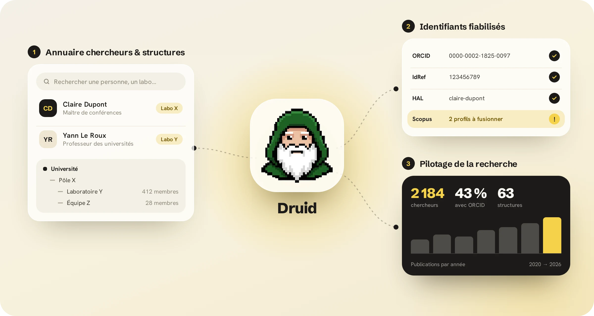

# Druid — Directory for Researchers, Units & Identifiers

<p align="center">
  
</p>

**Druid** gère l'annuaire de la recherche d'un établissement, fiabilise les identifiants des chercheurs et des
structures, et sert à piloter sa production scientifique : tableaux de bord, collaborations, appels à projets.
Il est développé par Guillaume Godet, service Bibliométrie du SCD de Nantes Université, et s'inscrit dans
l'écosystème [CRISalid](https://github.com/CRISalid-esr).

- **Démo publique** (données fictives, lecture seule) : <https://druid-demo.pages.dev>
- **Centre d'aide** : <https://druid-aide.guillaumegodet.workers.dev>


---

## Fonctionnalités

### 1. Annuaire des chercheurs et des structures

- **Personnes** : fiches des personnels de recherche (emploi, employeur, appartenances aux labos et équipes avec leur
  type, dates précises ou approximatives, statut Interne / Départ / Parti / Externe, ETP recherche), avec recherche,
  filtres et exports CSV, Excel et PDF. La fiche montre aussi la **thèse de doctorat** (lue sur theses.fr), le
  **parcours d'affiliations** déduit des publications, les **appels à projets** où la personne a été retenue et ses
  **binômes de recherche** (coauteurs fréquents et rapprochements suggérés, à juger d'un geste).
- **Structures** : pôles, laboratoires et équipes, avec leurs tutelles et leurs identifiants (RNSR, ROR, HAL,
  OpenAlex, IdRef, Wikidata, ISNI, UAI, SIRET…). Le labo de rattachement d'une personne se déduit de ses appartenances.
- **Groupes** : listes de chercheurs à la demande, qui ont chacune leur tableau de bord.
- **Synchronisation avec l'annuaire LDAP** : une revue des écarts avant toute mise à jour, par lots. Les statuts
  validés à partir d'une liste fiable passent avant le LDAP et expirent au bout de 18 mois.
- **Import d'une liste de site** (annuaire d'un labo scrappé par le back-end) : écran de revue, créations et
  compléments appliqués en un clic.
- **Rubrique « À traiter »** : les doublons à fusionner et les tâches à mener hors de Druid (doctorants ayant
  soutenu, identifiants partagés…), avec des e-mails prêts à copier.
- **Chiffres clés** de la liste (fiches, présents, HDR, parité, ORCID), qui suivent les filtres ; les analyses
  d'effectifs complètes sont dans le tableau de bord (famille **Effectifs › Annuaire**).

### 2. Identifiants fiabilisés

- **Une page unique, « Alignement des identifiants »**, pour les **personnes** — IdRef, ORCID, HAL (IdHAL et
  personnes HAL sans IdHAL), OpenAlex, Scopus — et pour les **structures** (RNSR, ROR, AuréHAL, OpenAlex, IdRef,
  Wikidata, passerelles d'abord puis recherche par nom). Elle ne liste que ce qui demande une action : candidat à
  confirmer, profils à fusionner, notice remplacée ou fermée.
- **Export ABES** : un classeur XLSX pour faire créer ou enrichir les notices IdRef d'un labo.
- **Export vers CRISalid** : les fichiers `people.csv` et `structures.csv` pour le *directory bridge* ; les
  identifiants retirés ou corrigés sont envoyés au graphe CRISalid par le bus (file d'attente, publieur nocturne).
- **Jetons de service** : le back-end bibliométrique lit l'annuaire par l'API (`/api/v1`) sans session.

### 3. Pilotage de la recherche

Le tableau de bord bibliométrique (ECharts) s'appuie sur les exports d'un back-end
([druid-biblio](https://github.com/guillaumegodet/druid-biblio)) qui agrège CRISalid, OpenAlex, HAL et le Baromètre
de la science ouverte (BSO). Ses analyses sont rangées en **sept familles** :

| Famille | Vues |
|---|---|
| **Vue d'ensemble** | chiffres clés, évolution, types, accès ouvert, mots-clés, grille « Explorer les analyses » |
| **Publications** | ouvrages, revues, liste des publications, sources |
| **Impact** | impact et citations, benchmark |
| **Collaborations** | partenariats (nationaux, internationaux, par pays, par établissement partenaire ou consortium), **binômes de chercheurs** (observés, et rapprochements suggérés par les coauteurs communs, les sujets, les références communes et les citations), réseau de cosignatures inter-labos |
| **Effectifs** | annuaire du jour, chercheurs (taux de publication par ETP, pyramide des âges), équipes, doctorants |
| **Pilotage** | axes stratégiques (avec curation), financements, **appels à projets** (Horizon Europe, ERC, MSCA, ANR, appels saisis à la main : chercheurs appariés à chaque appel, candidats aux appels réservés par étape de carrière, assistant « Mon projet »), suivi des APC, charte de signature |
| **Veille** | nouvelles publications (lues sur OpenAlex), mentions dans les médias, newsletter |

- **Mes rapports** : des rapports personnalisables à partir des graphiques, partageables et exportables en PDF, avec
  des commentaires rédigés par un modèle de langue.
- **Export des graphiques** en SVG, PDF vectoriel et CSV ; chaque graphique peut s'afficher hors authentification
  (`/embed`), et un lien direct restitue la vue complète.

### Aide et assistants

- **Centre d'aide** ([`help/`](help/), site Starlight) : guides, tutoriels et sources des données. Un bouton « ? »
  ouvre, depuis chaque écran, la page d'aide qui lui correspond. Un assistant « Aide Druid » répond aux questions à
  partir de cette documentation.
- **Assistant de recherche CRISalid** : un chat relayé vers l'agent conversationnel adossé au graphe CRISalid.
- **Mon projet** : décrire un projet et obtenir les appels ouverts qui lui correspondent.

---

## Instances

Le même code sert plusieurs instances. Chacune se configure par variables d'environnement (serveur Node) ou par
son `instance.json` (Cloudflare), et `/api/me` expose ses capacités (LDAP, ETL, appels à projets, réseau…) :

| Instance | Hébergement | Données | Particularités |
|---|---|---|---|
| Nantes Université | Docker (`server.cjs`) | PostgreSQL | Keycloak, LDAP, ETL bibliométrique, bus CRISalid, assistants |
| Centrale Nantes | Cloudflare Pages + Functions | PostgreSQL (Clever Cloud, via Hyperdrive) | derrière Cloudflare Access ; données dans un dépôt privé |
| Démo publique | Cloudflare Pages + Functions | PostgreSQL (Neon, via Hyperdrive), rechargée à chaque déploiement | lecture seule, données fictives, toutes les vues |
| Déploiement multi-établissements | Cloudflare Pages + Functions + runner Node | un schéma PostgreSQL par établissement | portail « Créer mon Druid », lien magique, offres |

Les réglages des instances Cloudflare sont décrits dans [`instances/README.md`](instances/README.md).

## Stack technique

- **Front** : React 19 + TypeScript, Vite, Tailwind CSS, icônes Lucide ; ECharts (tableau de bord) ; LinguiJS
  (interface anglais / français).
- **Serveur** : `server.cjs` (Express), avec authentification Keycloak (OIDC), API métier de l'annuaire
  (`/api/v1`, Hono, partagée avec Cloudflare), API du tableau de bord, de la veille, des appels à projets et des
  chats. Sur Cloudflare, des Pages Functions (`functions/`) jouent ce rôle avec les mêmes modules.
- **Données** : **PostgreSQL** (schéma versionné dans `db/migrations`, migrations dbmate, requêtes Kysely, journal
  d'audit) ; exports du back-end bibliométrique montés en lecture seule ; validation par Zod. Le stockage Grist des
  débuts reste disponible (`DRUID_STORAGE=grist`) pour la transition, le document n'est plus la source de vérité.
- **Scripts** (`scripts/`) : synchronisations LDAP, IdRef, ORCID, HAL, OpenAlex et Scopus, alignement des structures,
  collecte des appels (portail Funding & Tenders, ANR) et calcul des éligibilités, thèses (theses.fr), fusion des
  doublons, export ABES, import Grist → PostgreSQL, seed des démos, publieur du graphe, runner multi-établissements.

## Développement

```bash
npm install
npm run dev          # front seul (Vite)
npm run build        # puis `node server.cjs` pour le serveur complet (auth, API, jobs)
npm test             # Vitest (unitaires)
npm run db:migrate   # migrations sur DATABASE_URL (rôle propriétaire)
npm run test:db      # tests d'intégration PostgreSQL (DATABASE_URL)
```

Principales variables d'environnement (`.env`) :

- `DRUID_STORAGE` : `postgres` (recommandé) avec `DRUID_DATABASE_URL` (rôle `druid_app`, voir `db/roles.sql`) ; ou
  `grist` (par défaut, transition) avec `VITE_GRIST_DOC_ID` et `GRIST_API_KEY` **côté serveur uniquement**. Le
  serveur et les jobs (`scripts/lib/storage.cjs`) suivent le même réglage.
- `KEYCLOAK_URL`, `KEYCLOAK_REALM`, `KEYCLOAK_CLIENT_ID`, `APP_URL`, `SESSION_SECRET` : authentification et session ;
  `KEYCLOAK_ESTABLISHMENT_GROUP`, `KEYCLOAK_LAB_VIEWER_GROUP` : groupes qui portent les droits établissement / labo.
- `DRUID_SERVICE_TOKENS` : jetons de service des clients machine (druid-biblio…), qui lisent l'annuaire sans session
  (`Authorization: Bearer <jeton>`, routes `GET /api/v1/people[?lab=]`, `/structures`, `/institutions`,
  `/structures/identifiers`, chaque lecture journalisée). Entrées `<nom>:<empreinte sha256>` séparées par des
  virgules ; le serveur ne garde que l'empreinte. Nouveau jeton : `node scripts/lib/service_tokens.cjs new <nom>`.
- `LDAP_URL`, `LDAP_BIND_DN`, `LDAP_BIND_PASSWORD` : synchronisation LDAP (sans valeur par défaut).
- `ETL_API_URL`, `DASHBOARD_SHARED_SECRET`, `BIBLIO_DATA_PATH` : back-end bibliométrique (tableau de bord, console
  ETL, groupes, réseau de cosignatures `network.json`).
- `DRUID_AMQP_URL`, `DRUID_GRAPH_ACTIONS` (`off` | `dry-run` | `on`) : envoi au graphe CRISalid des retraits
  d'identifiants.
- `ILAAS_API_KEY`, `ILAAS_MODEL`, `EMBEDDING_API_URL`, `EMBEDDING_API_MODEL` : modèles de langue (rapports,
  assistant « Mon projet », traductions des appels) ; `PIPELINES_URL`, `PIPELINES_API_KEY` : assistant de recherche
  CRISalid.
- `OPENALEX_API_KEY`, `SCOPUS_API_KEY` : clés des sources externes (veille, alignement Scopus).
- `VITE_HELP_URL` : adresse du centre d'aide.
- `DRUID_ENV` : environnement affiché (`production` par défaut ; toute autre valeur, par exemple `test`,
  ajoute un bandeau en haut de l'application).

En production, l'image Docker (`Dockerfile`, `node server.cjs` sur le port 3000) est lancée par le projet
compose de l'établissement, hors de ce dépôt, avec un conteneur `druid-migrate` (dbmate) qui applique les
migrations avant le démarrage. Aucun réglage d'instance n'est compilé dans l'image (le front reçoit sa
configuration par `/api/me`) : la même image sert l'instance de test et la production.

**Version et santé.** `npm run build` écrit `build-info.json` (version de `package.json`, commit, date ;
script `scripts/build-info.cjs`). La version s'affiche sous le logo et dans `/api/me` (`build`). Dans
l'image Docker, le commit et la date arrivent par les arguments de build `GIT_SHA` et `BUILD_DATE`, et
sont aussi posés en labels OCI (`docker inspect`). `GET /api/health` (public, sans session) répond
`{"status":"ok"}` et sert au `HEALTHCHECK` de l'image.

### Branches, versions et mises en production

Évolutions par branche et pull request (CI obligatoire : types, tests, langue des commentaires, gardes, build
Cloudflare, schéma PostgreSQL), versions numérotées SemVer, environnement de test séparé de la production : voir
[`CONTRIBUTING.md`](CONTRIBUTING.md). Les changements de chaque version sont dans [`CHANGELOG.md`](CHANGELOG.md).

### Langues et conventions

- **Interface bilingue anglais / français**, gérée avec LinguiJS : les chaînes sources sont en anglais, les
  traductions dans `locales/fr/messages.po`. Après tout ajout de chaîne, lancer `npm run i18n:extract`, puis
  traduire.
- **Le code est en anglais** (commentaires, logs, messages d'erreur) ; `npm test` refuse un commentaire en
  français.

## Structure du dépôt

| Dossier | Contenu |
|---|---|
| `server.cjs`, `server/` | serveur Express, point d'entrée du conteneur ; API métier `/api/v1` |
| `components/` | interface : personnes, structures, groupes, alignement, tableau de bord, rapports, administration |
| `lib/`, `hooks/` | règles métier (statuts, dates, validation, alignements, appels, binômes), dépôt PostgreSQL, schémas Zod |
| `db/` | migrations PostgreSQL (dbmate), rôles, schéma du plan de contrôle multi-établissements |
| `scripts/` | synchronisations, collectes, migrations et exports en ligne de commande |
| `functions/` | Cloudflare Pages Functions (mêmes modules que le serveur) |
| `instances/` | instances Cloudflare sans donnée personnelle (démos) : `instance.json`, données fictives |
| `help/` | centre d'aide (Starlight) |
| `locales/` | catalogues de traduction |

## Données personnelles

Ce dépôt ne contient aucune donnée personnelle. Les données de test et de démonstration sont fictives :
identifiants ORCID et IdRef à clé de contrôle volontairement fausse, adresses `example.org`, appels à projets
inventés. `scripts/publication/check_public_tree.mjs` le vérifie avant chaque publication.

## Licence

Druid est distribué sous licence [CeCILL v2.1](LICENCE)

## Contact

Pour une question, un nouveau graphique ou une nouvelle source de données, ouvrir une *issue* ou contactez-moi
